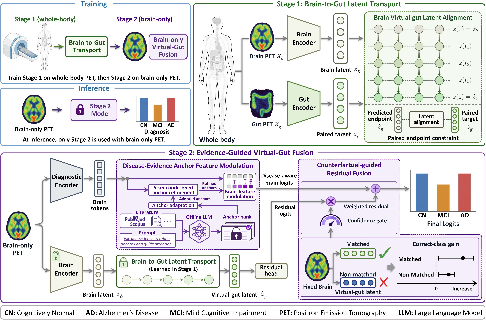

# BRIDGE

PyTorch implementation of **BRIDGE: Learning Brain-Gut Metabolic Evidence for Alzheimer's Disease Diagnosis**.

BRIDGE learns brain-to-gut metabolic correspondence from paired PET and integrates virtual-gut evidence through reliability-gated fusion. At inference, only brain PET is required. The implementation supports CN/MCI and CN/AD classification.



## Installation

Python 3.10+ is required. Install a PyTorch build compatible with your CUDA environment, then run:

```bash
python -m pip install -e ".[dev]"
```

CUDA is selected automatically when available; CPU execution is also supported.

## Data Preparation

Prepare preprocessed NIfTI volumes and CSV manifests using the formats in `examples/`:

| Stage | Required columns |
| --- | --- |
| Brain-to-gut transport | `subject_id`, `brain_path`, `gut_path` |
| Diagnosis | `subject_id`, `brain_path`, `label`, `fold` |

Diagnosis labels are `CN`, `MCI`, and `AD` (or `0`, `1`, and `2`). Use diagnosis-stratified outer folds numbered 1–5; leave folds empty or zero to generate them automatically. Repeated examinations must share a `subject_id` or an optional `patient_id` to prevent patient overlap between partitions.

The diagnosis stage also requires an anchor file containing an `embeddings` tensor of shape `[K, latent_dim]`. Model weights, anchor embeddings, and training/test data are not included. Files in `examples/` contain format examples only.

## Training and Evaluation

Run commands from the repository root. Training parameters are defined in `configs/bridge.yaml`; `configs/demo.yaml` provides a small CPU configuration.

**Stage 1: Brain-to-gut transport**

```bash
python scripts/train_transport.py --manifest /path/to/paired.csv --config configs/bridge.yaml --output runs/transport
```

**Stage 2: Diagnosis**

```bash
python scripts/train_diagnosis.py --manifest /path/to/diagnosis.csv --anchors /path/to/anchors.pt --transport runs/transport/transport.pt --config configs/bridge.yaml --task CN/MCI --output runs/diagnosis
```

Use `--task CN/AD` for CN/AD classification, or `--fold 1` to run a single fold. For source-to-private transfer, add `--source-cerebral /path/to/cerebral.pt` to load a source-validation-selected cerebral checkpoint with matching binary labels and disjoint patient IDs. Otherwise, cerebral initialization uses the current cohort's training partition.

Five-fold evaluation uses patient-disjoint training, validation, and test partitions of approximately **70%/10%/20%**. Checkpoint selection and early stopping use validation loss. Test ROC-AUC is calculated from positive-class probabilities, with MCI or AD as the positive class.

Each fold saves its AUC in `metrics.json`. A complete five-fold run saves `auc.json` under `runs/diagnosis/CN_MCI/` or `CN_AD/`, containing `fold_auc`, `mean_auc`, and `std_auc` (sample standard deviation).

Run the tests with:

```bash
python -m pytest -q
```

## Citation

If you find this work useful, please cite:

```bibtex
@article{zhu2026bridge,
  title={BRIDGE: Learning Brain-Gut Metabolic Evidence for Alzheimer's Disease Diagnosis},
  author={Zhu, Pengli and Chang, Ruxi and Yao, Tianliang and Jiang, Yu and Liu, Shengyuan and Lin, Yiyang and Duan, Xiaoyi and Wu, Shuang and Yuan, Yixuan and Alzheimer's Disease Neuroimaging Initiative and others},
  journal={arXiv preprint arXiv:2610.39520},
  year={2026}
}
```

## License

This project is released under the [MIT License](LICENSE).
